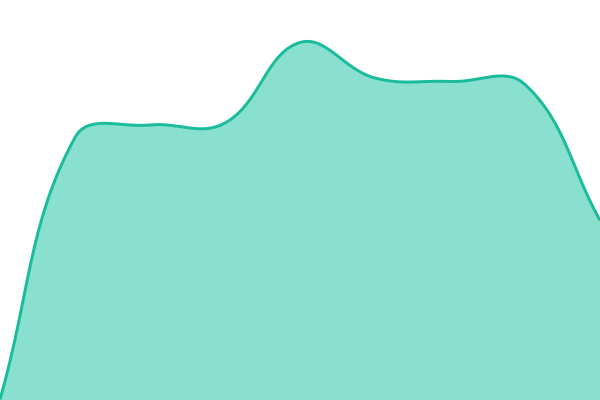

# Concertos status

This repository contains the open-source uptime monitor and status page for [concertos-status](https://status.concertos.live), powered by [Upptime](https://github.com/upptime/upptime).

<!--start: status pages-->
<!-- This summary is generated by Upptime (https://github.com/upptime/upptime) -->
<!-- Do not edit this manually, your changes will be overwritten -->
<!-- prettier-ignore -->
| URL | Status | History | Response Time | Uptime |
| --- | ------ | ------- | ------------- | ------ |
|  [Website](https://concertos.live/login) | 🟩 Up | [website.yml](https://github.com/concertos-status/status/commits/HEAD/history/website.yml) | 

 577ms
     
 | 

<a href="https://status.concertos.live/history/website">100.00%</a>
    

|  [Tracker](https://concertos.live/announce/status-check) | 🟩 Up | [tracker.yml](https://github.com/concertos-status/status/commits/HEAD/history/tracker.yml) | 

 426ms
     
 | 

<a href="https://status.concertos.live/history/tracker">100.00%</a>
    

|  [IRC](concertos.live) | 🟩 Up | [irc.yml](https://github.com/concertos-status/status/commits/HEAD/history/irc.yml) | 

 140ms
     
 | 

<a href="https://status.concertos.live/history/irc">100.00%</a>
    

|  [Live chat](concertos.live) | 🟩 Up | [chat.yml](https://github.com/concertos-status/status/commits/HEAD/history/chat.yml) | 

 140ms
     
 | 

<a href="https://status.concertos.live/history/chat">100.00%</a>
    

<!--end: status pages-->

Built with [Upptime](https://upptime.js.org), MIT licence.
